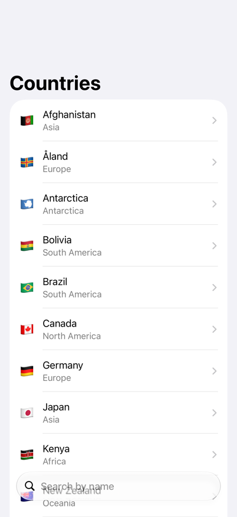
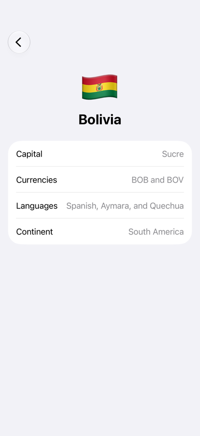
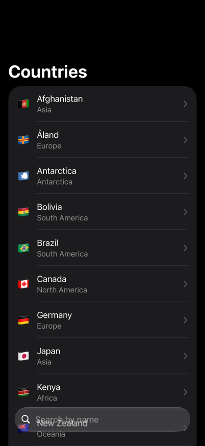
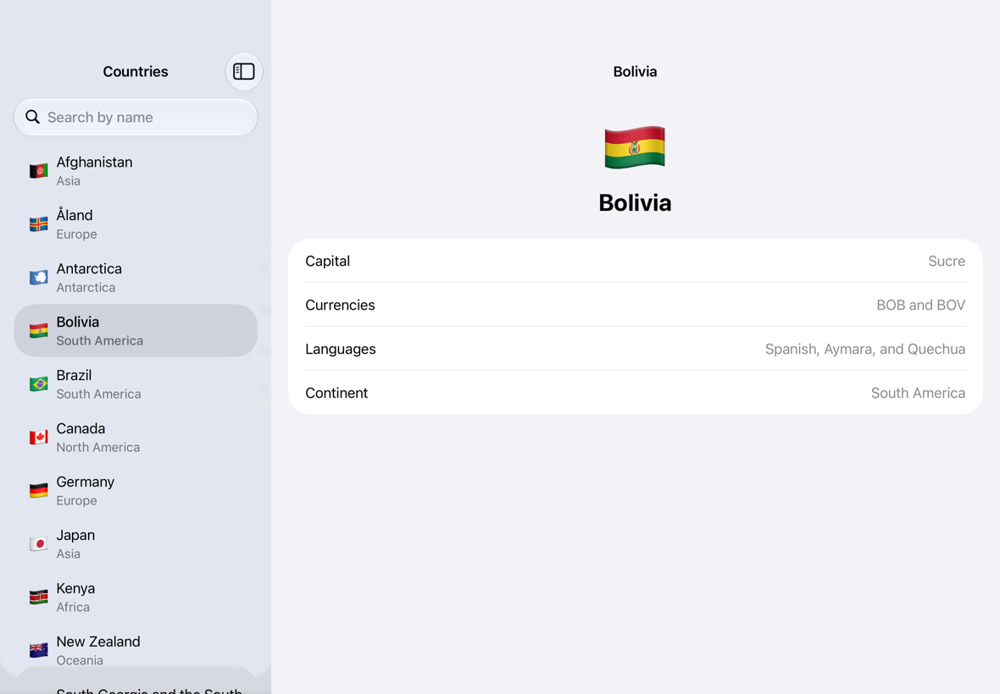

# Countries

[](https://github.com/constzz/countries-ios/actions/workflows/ci.yml?query=branch%3Amain)
[](https://github.com/constzz/countries-ios/actions/workflows/snapshots.yml?query=branch%3Amain)

A SwiftUI app for browsing the world's countries, backed by the public [Countries GraphQL API](https://countries.trevorblades.com) through Apollo iOS. Search the list by name, then open a country to see its capital, currencies, languages and continent.

## Screenshots
These are reference images from the snapshot tests, so the Snapshots workflow checks on every pull request and every merge to main that the app still renders them.

<p>
  
  
  
  
</p>


## Build and run
**Requirements:** Xcode 26.0.1 or later, iOS 17.0 or later.

Open `CountriesApp.xcodeproj` and press ⌘R. Nothing else needs installing: the generated GraphQL code is committed, and Apollo iOS is the only package dependency.

Developed with Xcode 27.1 (27A9269) on the iPhone 17 Pro / iOS 27.0 simulator.

### Tested with
| Xcode | Simulator | Local | CI |
|---|---|---|---|
| 27.1 | iPhone 17 Pro, iOS 27.0 | ✓ (with snapshots) | every pull request and push to main; snapshots in their own workflow |
| 27.1 | iPhone 15 Pro, iOS 17.0 | ✓ | not run: no CI image has the iOS 17.0 runtime |
| 26.0.1 | iPhone 17 Pro, iOS 26.0 | ✓ | every pull request and push to main |

### Commands
| Task | Command |
|---|---|
| All tests | `xcodebuild test -scheme CountriesApp -testPlan CountriesApp -destination 'platform=iOS Simulator,name=iPhone 17 Pro,OS=27.0' -collect-test-diagnostics never` |
| Test matrix (Xcode 26 and 27) | `scripts/test-matrix.sh` |
| Lint | `scripts/lint.sh` (needs `brew install swiftlint swiftformat`) |
| Record snapshots | the `RecordSnapshots` test plan ([details](docs/DEVELOPMENT.md#snapshot-tests)) |
| Codegen | [docs/DEVELOPMENT.md](docs/DEVELOPMENT.md#codegen) |

To check right-to-left layout or long text: Edit Scheme → Run → Options → App Language → Right-to-Left Pseudolanguage or Double-Length Pseudolanguage.

## Architecture
Three local Swift packages with one dependency direction: `CountriesUI → CountriesDomain ← CountriesData`. The domain package defines the models, the repository protocol and the error type. The data package implements the repository with Apollo iOS and keeps every generated type internal. The UI package has the screens and their `@MainActor @Observable` view models, and never sees Apollo. The app target composes the three.

```
                      CountriesApp
              │               │               │
              ▼               ▼               ▼
        CountriesUI ──► CountriesDomain ◄── CountriesData ──► Apollo iOS
```

More in [docs/ARCHITECTURE.md](docs/ARCHITECTURE.md), [docs/UI_GUIDELINES.md](docs/UI_GUIDELINES.md) and [docs/DEVELOPMENT.md](docs/DEVELOPMENT.md).

## Delivery
The work ships as user stories, each with its own spec, branch and pull request:

| Story | Spec |
|---|---|
| US-0 Project setup | [us-0-project-setup.md](docs/specs/us-0-project-setup.md) |
| US-1 Country list | [us-1-country-list.md](docs/specs/us-1-country-list.md) |
| US-2 Country detail | [us-2-country-detail.md](docs/specs/us-2-country-detail.md) |

## Requirements map
Each requirement of the task traces to an acceptance criterion and the test that checks it. Filled in per story.

| Requirement | Story / AC | Test |
|---|---|---|
| At least two local Swift packages (data and UI) | US-0 / AC-0.6 | build |
| Swift 6 strict concurrency | US-0 / AC-0.2 | warnings-as-errors build |
| SwiftLint and SwiftFormat | US-0 / AC-0.4 | `scripts/lint.sh` |
| A list of countries with flag, name and continent | US-1 / AC-1.1 | `CountriesRepositoryTests`, `CountryListViewModelTests`, `COUNTRY_LIST_LOADED_*` snapshots |
| Search by name, debounced with Combine | US-1 / AC-1.2, AC-1.3 | `CountryListSearchInputTests`, `SearchPatternTests`, `CountriesRepositoryTests` |
| Loading, empty and error states | US-1 / AC-1.4 to AC-1.6, AC-1.9 | `CountryListViewModelTests`, `ErrorCopyTests`, `CountryListSnapshotTests` |
| `@Observable` and `@MainActor` view models | US-1 / AC-1.1, AC-1.11 | `CountryListViewModelTests` |
| Tests with a mocked network boundary | US-1 / AC-1.1, AC-1.3, AC-1.8, US-2 / AC-2.4 | `FakeGraphQLClient` in the data tests, `StubURLSession` under a real `ApolloClient` for the cache, `MockCountriesRepository` in the view-model tests |
| A test of the GraphQL to domain mapping | US-1 / AC-1.1, US-2 / AC-2.2, AC-2.3 | `CountrySummaryMappingTests`, `CountryDetailsMappingTests` |
| Tap a country to see its name, flag, capital, currencies, languages and continent | US-2 / AC-2.1 to AC-2.3 | `CountryDetailsMappingTests`, `CountryDetailValuesTests`, `COUNTRY_DETAIL_*` snapshots, manual check |
| Detail loading and error states | US-2 / AC-2.4, AC-2.5, AC-2.10 | `CountryDetailViewModelTests`, `CountriesRepositoryTests`, `ErrorCopyTests`, `CountryDetailSnapshotTests` |
| The detail loads from its own query | US-2 / AC-2.4 | `CountriesRepositoryTests`, `CountryDetailViewModelTests` |

## How to see each state
- Snapshot images: every screen state on every device, in light and dark, in [`CountriesUISnapshotTests/snapshots`](CountriesUISnapshotTests/snapshots).
- SwiftUI previews for each screen.
- In the app: search "zzz" for the empty state; select Antarctica for "None" values; turn the Mac's network off, or set Network Link Conditioner to 100% loss, for the offline and error states.

## Key decisions
- **Search runs on the server, debounced.** The API's `name` filter takes a regex, so typing sends at most one query per 300 ms pause, and an unchanged term sends none. The term is escaped and each letter becomes a class of both cases, because the API's regex is case-sensitive and an unbalanced `(` is a server error. Rejected: loading all 250 countries once and filtering on the device, which matches better (diacritics included) but leaves the debounce nothing to gate.
- **MVI on each screen, on a shared base.** Every screen conforms to the same small types in `CountriesUI/Architecture/`: one state value, one action enum, an effect enum for one-time UI events, and a view model that subclasses `MVIViewModel` and overrides `reduce`. `reduce` is the only place the state changes; its handlers start async work through `launchEffect`, and the result comes back as an action. Each type has its own file. Rejected: a separate pure reducer returning effects as values, which splits each screen across two types, and a view model with an event method per interaction and several observable properties.
- **Combine only in the search field's input pipe**, where the debounce lives. Everything else is async/await.
- **One request at a time.** A new load, search, refresh or retry cancels the one in flight, and `reduce` ignores any response that doesn't answer the latest request.
- **The detail loads from its own query.** It takes only the country code and shows loading until `CountryQuery` answers; both queries share the `CountryBasics` fragment and its mapper, so each screen can change its fields alone. Rejected: showing the list's summary at once while the rest loads, which couples the two screens.
- **Selection lives in the root view, per window.** `@SceneStorage` holds the selected code, so each window restores it after relaunch, and size changes keep it. Rows are `NavigationLink`s in `List(selection:)`, so the split view highlights, pushes and clears the selection itself, and each country gets a new detail view and view model.
- **Snapshots of every state on every device**, light and dark, drawn at @1x and matched within 2 of 255 per color channel, because Liquid Glass over a search field holding text varies by that much between runs ([details](docs/specs/us-1-country-list.md#decisions)).

## Left out
- A custom EnvironmentValues entry. Dependencies come in through `init`, and two shallow screens have no value the environment would carry better: locale, Dynamic Type and color scheme are SwiftUI's own. The custom ViewModifier, `.loadState`, is in, and both screens use it.
- Diacritic-insensitive search: "Reunion" doesn't find "Réunion", because the API's regex matches the names as written.
- Localized country and continent names: they stay in English, because search matches the English names. Currencies show as ISO codes and languages by their English names, as the API gives them.

## With more time
- UI tests, with accessibility identifiers and a stub repository chosen by launch argument. They would also cover selecting, going back and size changes, which are checked by hand today.
- An automated test of the 15 s timeout, with a network transport that never answers. Today it's checked by hand.
- Apollo cache keys by country `code`, so the list and detail queries share cached countries.
- Snapshots of iPad multitasking window sizes and the iPhone Duo's rotated postures.
