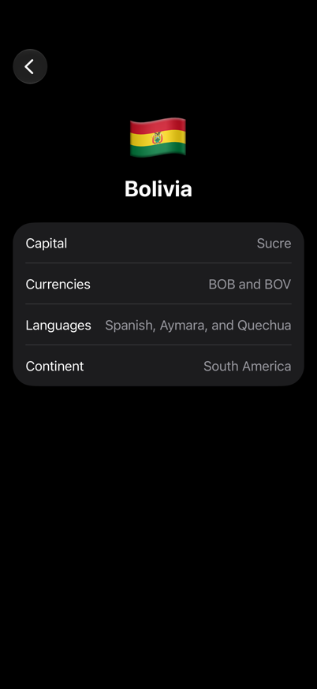
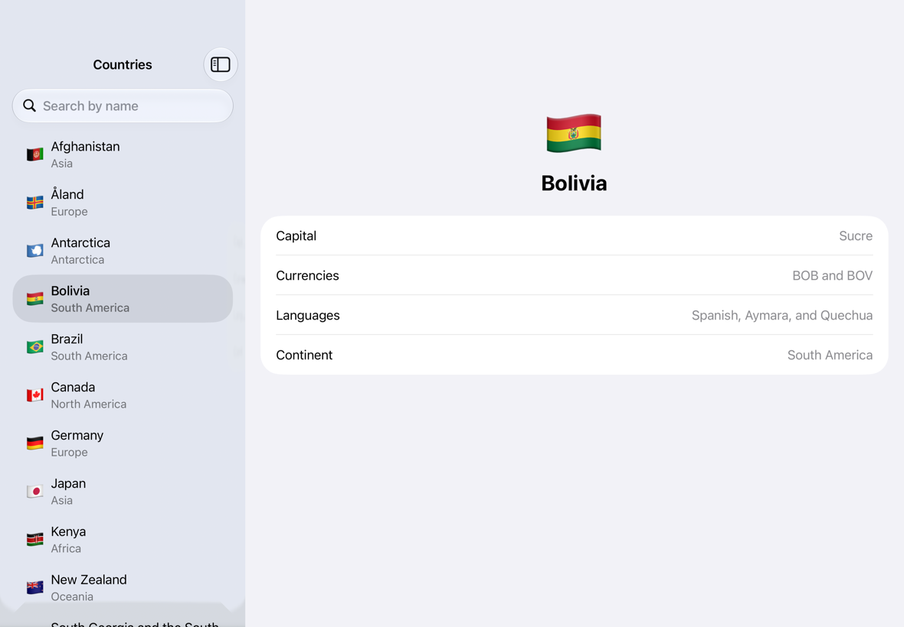

# Atlas

[](https://github.com/constzz/countries-ios/actions/workflows/ci.yml?query=branch%3Amain)
[](https://github.com/constzz/countries-ios/actions/workflows/snapshots.yml?query=branch%3Amain)

Atlas browses the world's countries from the public [Countries GraphQL API](https://countries.trevorblades.com). I built it as a take-home exercise: SwiftUI and Apollo iOS, split into local Swift packages, with a data layer that's tested without the network. Search the list by name, then open a country to see its capital, currencies, languages and continent.

<p>
  
  
  
  
</p>


The images are the snapshot tests' reference images, so CI fails if the app stops rendering them.

## Where to look
If you have ten minutes, these five places show the most:

1. [`CountriesRepositoryImpl`](Packages/AtlasData/Sources/AtlasData/CountriesRepositoryImpl.swift) and [`CountriesRemoteDataSourceImpl`](Packages/AtlasData/Sources/AtlasData/DataSources/CountriesRemoteDataSourceImpl.swift). Apollo stops at the remote data source, which returns generated types. The repository maps them to domain types and decides whether a request needs the network at all. The generated code is compiled into AtlasData as `internal`, so the compiler keeps generated types out of the UI. [`SearchPattern`](Packages/AtlasData/Sources/AtlasData/SearchPattern.swift) works around the API's case-sensitive regex filter.
2. [`CountryListViewModel`](Packages/AtlasUI/Sources/AtlasUI/CountryList/ViewModel/CountryListViewModel.swift) and [its tests](Packages/AtlasUI/Tests/AtlasUITests/CountryListViewModelTests.swift). Load, search, refresh and retry all go through one `reduce`. The tests move a test scheduler and clock by hand, so they check the real 300 ms debounce without sleeping.
3. The cache, and the bug that moved it. While testing retry I found that Apollo caches the data of a response that also has GraphQL errors, with each failed field stored as `null`. Read back with `.cacheFirst`, a country that had failed to load showed as "not found" until relaunch. I first fixed that with a cache interceptor. When I split the data layer into data sources, the cache moved into the repository: [`InMemoryCache`](Packages/AtlasData/Sources/AtlasData/DataSources/InMemoryCache.swift) holds only mapped successes, and [`NoCacheInterceptor`](Packages/AtlasData/Sources/AtlasData/Interceptors/NoCacheInterceptor.swift) keeps Apollo's store empty. Two [repository tests](Packages/AtlasData/Tests/AtlasDataTests/CountriesRepositoryTests.swift) run a real `ApolloClient` over a stubbed `URLSession` to pin it down.
4. [The US-1 spec](docs/specs/us-1-country-list.md) and [PR #2](https://github.com/constzz/countries-ios/pull/2), to see how each story went: acceptance criteria first, then tests named after them, then the code, in red and green commits.
5. [The snapshot images](AtlasUISnapshotTests/snapshots): every screen state, with the content states on iPhone, iPhone Duo and iPad in light and dark, plus the largest accessibility text size and right-to-left.

## Build and run
- **Xcode:** 26.0.1 or later. I developed on Xcode 27.1 (27A9269).
- **Deployment target:** iOS 17.0, the first release with the Observation framework.
- **Simulator:** iPhone 17 Pro, iOS 27.0.

Open `Atlas.xcodeproj` and press ⌘R. There's nothing to install: the generated GraphQL code is committed, and Apollo iOS 2.4.0 is the only dependency, pinned to that exact version.

### Tested with
| Xcode | Simulator | Local | CI |
|---|---|---|---|
| 27.1 | iPhone 17 Pro, iOS 27.0 | ✓ (with snapshots) | every pull request and push to main; snapshots in their own workflow |
| 27.1 | iPhone 15 Pro, iOS 17.0 | ✓ | not run: no CI image has the iOS 17.0 runtime |
| 26.0.1 | iPhone 17 Pro, iOS 26.0 | ✓ | every pull request and push to main |

### Commands
| Task | Command |
|---|---|
| All tests | `xcodebuild test -scheme Atlas -testPlan Atlas -destination 'platform=iOS Simulator,name=iPhone 17 Pro,OS=27.0' -collect-test-diagnostics never` |
| Test matrix (Xcode 26 and 27) | `scripts/test-matrix.sh` |
| Lint | `scripts/lint.sh` (needs `brew install swiftlint swiftformat`) |
| Record snapshots | the `RecordSnapshots` test plan ([details](docs/DEVELOPMENT.md#snapshot-tests)) |
| Codegen | [docs/DEVELOPMENT.md](docs/DEVELOPMENT.md#codegen) |

To check right-to-left layout or long text, choose Edit Scheme → Run → Options → App Language → Right-to-Left Pseudolanguage or Double-Length Pseudolanguage.

## Architecture
```
                       Atlas
           │             │              │
           ▼             ▼              ▼
        AtlasUI ──► AtlasDomain ◄── AtlasData ──► Apollo iOS
           │
           ▼
        AtlasMVI
```

AtlasDomain has the models, the use cases, the `CountriesRepository` protocol and `RequestError`, and imports only Foundation. AtlasData implements the repository over two data sources: the API, through Apollo iOS, and an in-memory cache. AtlasUI has the two screens and their `@MainActor @Observable` view models, which call use cases and never import Apollo. AtlasMVI is the small base both view models subclass. The app target reads the API URL from its Info.plist, builds the repository and the use cases over it, and hands the use cases to the root view; that's all it does.

A request always takes the same path: view model → use case → repository → data sources.

Every target builds in the Swift 6 language mode with complete concurrency checking, and a warning fails the build.

The details are in [ARCHITECTURE.md](docs/ARCHITECTURE.md), [UI_GUIDELINES.md](docs/UI_GUIDELINES.md) and [DEVELOPMENT.md](docs/DEVELOPMENT.md).

## Key decisions
- **I search on the server.** The brief ties the debounce to "a query is not issued on every keystroke", and the API has a `name` filter, so typing sends at most one query per 300 ms pause, and none when the trimmed term hasn't changed. The filter is a case-sensitive regex with no case-insensitive flag, so each letter becomes a class of both cases (`fr` becomes `[fF][rR]`), and metacharacters are escaped, because an unbalanced `(` is a server error. I rejected loading all 250 countries once and filtering on the device. It matches better, diacritics included, but leaves the debounce with nothing to gate.
- **Each screen is MVI on a small shared base.** A view model subclasses `MVIViewModel` and overrides `reduce`, the only place its state changes. Actions come from the view, events come back from the view model's own async work, and effects are one-time UI events such as a VoiceOver announcement. For two screens that's more structure than they strictly need. I chose it because the tricky parts of this app are about order: a search that answers after a newer one, a retry during a refresh. With one `reduce`, each of those is a test that sends actions and checks one state value. I rejected a pure reducer that returns effects as values, which splits each screen across two types, and a view model with one method and one observable property per interaction.
- **Combine appears only in the search field's input pipe**, where the debounce lives. Everything else is async/await, and no API in the app returns a publisher.
- **One request at a time.** A new load, search, refresh or retry cancels the request in flight, and a cancelled request never touches the state, so a slow search can't overwrite a newer one.
- **The detail screen loads from its own query.** It takes only a country code and shows loading until `CountryQuery` answers. Both queries spread the `CountryBasics` fragment and share its mapper, so either screen can add fields without touching the other. I rejected showing the list's row at once while the rest loads, which would tie the two screens together.
- **Every layer is there, even where it only passes the call on.** View models call use cases, use cases call the repository protocol, and the repository calls its data sources. `GetCountriesUseCase` holds a real rule: it sorts by name, because the API sorts by code. `GetCountryDetailsUseCase` only forwards the call. I kept it anyway, so both screens get their data the same way and the next rule has an obvious place to go. I started without use cases or data sources and added both in [PR #17](https://github.com/constzz/countries-ios/pull/17).
- **The repository owns the cache, and Apollo's is off.** The repository returns a mapped result from `InMemoryCache` when it has one. Otherwise it asks the remote data source, which always reaches the network. Pull-to-refresh skips the cached value, and only successes are stored, so Try Again after a failure always reaches the network. I rejected keeping Apollo's normalized cache inside the remote data source: the repository would have to pass Apollo's cache policies through, and Apollo also stores the data of responses that failed.
- **Generated code stays inside AtlasData.** Codegen writes into the data target with `internal` access instead of a separate generated module, so the compiler, not code review, keeps generated types out of the UI.
- **Selection lives in the root view, per window.** `@SceneStorage` keeps the selected country code, so each iPad window restores its own selection after relaunch, and rotating or folding keeps it. Rows are `NavigationLink`s in `List(selection:)`, so the split view highlights, pushes and clears the selection itself, and each country gets a fresh detail view and view model.
- **Snapshots allow 2/255 per color channel.** Liquid Glass over a search field with text in it renders slightly differently from run to run. Images are drawn at @1x, which took the list's images from 27 MB to under 7 MB ([details](docs/specs/us-1-country-list.md#decisions)).

## Beyond the brief
Some of the work went into things the brief didn't ask for. Each has a cost:

| Extra | Why | Cost, and what I'd cut under a deadline |
|---|---|---|
| Split view on iPad and iPhone Duo, with the selection restored per window | List and detail side by side is the standard layout on wide screens, and `NavigationSplitView` collapses to a push stack on iPhone by itself | Its selection cases (a search hides the selected row, the Duo folds, the app relaunches) are checked by hand until there are UI tests. I'd keep the split view and drop the restore after relaunch. |
| 75 snapshot images across five device presets, in light and dark, plus the largest accessibility size and right-to-left | They're how I checked dark mode, Dynamic Type and mirroring everywhere without clicking through each state | 8 MB in the repo, and a re-record after every visual change. I'd keep iPhone only. |
| AtlasMVI, a shared MVI base | One `reduce` per screen makes the ordering cases testable (see Key decisions) | A base class to learn. Two plain `@Observable` view models would also do. |
| Use cases and data sources between the screens and Apollo | A use case holds the rules about the data, the repository decides where the data comes from, and each data source talks to one store | More types to read, and one use case only passes the call on. Under a deadline I'd let view models call the repository until a use case has a rule. |
| Localization-ready: String Catalog, leading and trailing layout only, locale list formatting | Adding a language is a catalog change with no code changes | Little, done from the start. Retrofitting it later is what's expensive. |
| A spec per story, and tests named after its acceptance criteria | Every requirement in the brief traces to a criterion and a test ([map below](#requirements-map)) | Writing time. On a team, the ticket does this job. |
| CI on Xcode 26.0.1 and 27.1, with warnings as errors | A reviewer may open the project on either, and the brief asks for no concurrency warnings | CI minutes, and no iOS 27 APIs. |
| Timers on an injected scheduler and clock in tests | The debounce tests used to shorten the delays and sleep. Now they check the real 300 ms and 500 ms without waiting | A task-local time source in the MVI base. |

## Testing
123 `@Test` functions, all Swift Testing, run by one test plan. None touches the network, and each layer is tested against doubles of the layer below it.
- **Domain:** the use cases over `MockCountriesRepository`.
- **Data:** the mappers against JSON fixtures, `SearchPattern`, error mapping, the remote data source over `FakeGraphQLClient`, and the repository over `FakeCountriesRemoteDataSource` and a real cache. The Apollo client tests, and two repository tests of the whole data stack, run a real `ApolloClient` over `StubURLSession`.
- **View models:** driven through `send`, with real use cases over `MockCountriesRepository`, or over a suspending double when a test needs a request to stay in flight. Timers run on `TestScheduler` and `TestClock` from AtlasMVITesting.
- **Snapshots:** a small helper I wrote instead of adding a dependency. The tests run hosted by the app, because capturing Liquid Glass needs a window scene.
- Each test of a requirement starts with its acceptance criterion, as in `@Test("AC-1.5 no match shows the empty state with the query")`, so `grep -rn "AC-1\." Packages AtlasUISnapshotTests` lists everything that checks US-1.

To see each state yourself: the [snapshot images](AtlasUISnapshotTests/snapshots), the SwiftUI previews, or the app. Search "zzz" for the empty state, open Antarctica for "None" values, and turn the Mac's network off, or set Network Link Conditioner to 100% loss, for the offline and error states.

## Left out
- **A custom EnvironmentValues entry.** I added one for the repository in US-1 and removed it in US-2: only the root view read it, and the brief asks for an entry that more than one view needs. Locale, Dynamic Type and color scheme already come from SwiftUI's own entries. The custom ViewModifier, `.loadState`, is in, and both screens use it for their loading, empty and error states.
- **A package per feature.** One UI package with a folder per screen. Separate packages would need a shared design-system package, plus a string catalog and test target each, for two screens.
- **Diacritic-insensitive search.** "Reunion" doesn't find "Réunion", because the API's regex matches names as written.
- **Localized country and continent names.** They stay in English, because search matches the English names. Currencies show as ISO codes and languages by their English names, as the API returns them.
- **Offline storage.** The cache lives in memory only, so a cold start without a network shows the offline state.

## With more time
- UI tests, with accessibility identifiers and a stub repository chosen by launch argument. They'd cover navigation, going back, size changes and relaunch, which I check by hand today.
- An automated test of the 15 s timeout, with a transport that never answers. That's also checked by hand.
- A disk data source next to the in-memory cache, so a cold start without a network still shows the last list. Only the repository would change.
- Snapshots of iPad multitasking window sizes and the iPhone Duo's rotated postures.

## How I worked
Each story started with a spec in [`docs/specs`](docs/specs): what it delivers, its acceptance criteria and the decisions behind them. Tests came next, then the code. Red commits compile: a failing test runs against a stub instead of breaking the build. Each story merged as its own pull request with a merge commit, so `git log --graph` shows them.

| Story | Spec | Pull request |
|---|---|---|
| US-0 Project setup | [us-0-project-setup.md](docs/specs/us-0-project-setup.md) | [#1](https://github.com/constzz/countries-ios/pull/1) |
| US-1 Country list | [us-1-country-list.md](docs/specs/us-1-country-list.md) | [#2](https://github.com/constzz/countries-ios/pull/2) |
| US-2 Country detail | [us-2-country-detail.md](docs/specs/us-2-country-detail.md) | [#3](https://github.com/constzz/countries-ios/pull/3) |

The later pull requests (#4 to #17) are review and cleanup: design tokens, the rename to Atlas, deterministic timers, the MVI base in its own package, one way to build the system under test, and use cases with data sources.

## Requirements map
Each requirement in the brief, the acceptance criterion that covers it, and what checks it.

<details>
<summary>Show the map</summary>

| Requirement | Story / AC | Checked by |
|---|---|---|
| At least two local Swift packages, data and UI; the app target only composes | US-0 / AC-0.6 | build; `AtlasUI` has no Apollo dependency |
| The UI never sees Apollo-generated types | US-0 / AC-0.6 | generated code is `internal` to AtlasData |
| Strict concurrency, no warnings | US-0 / AC-0.2 | warnings-as-errors build on Xcode 26.0.1 and 27.1 |
| Schema downloaded, codegen configured | US-0 / AC-0.5 | [`apollo-codegen-config.json`](apollo-codegen-config.json); codegen reproduces the committed files with no diff |
| SwiftLint and SwiftFormat | US-0 / AC-0.4 | `scripts/lint.sh` in CI |
| A list of countries with flag, name and continent | US-1 / AC-1.1 | `GetCountriesUseCaseTests`, `CountriesRepositoryTests`, `CountryListViewModelTests`, `COUNTRY_LIST_LOADED_*` snapshots |
| Search by name, debounced with Combine | US-1 / AC-1.2, AC-1.3 | `CountryListSearchInputTests`, `SearchPatternTests`, `CountriesRemoteDataSourceTests` |
| Loading, empty and error states | US-1 / AC-1.4 to AC-1.6, AC-1.9 | `CountryListViewModelTests`, `ErrorCopyTests`, `CountryListSnapshotTests` |
| Stable row identity across reloads and filtering | US-1 / AC-1.7 | `CountryListViewModelTests`; a country's `code` is its `id` |
| `@Observable` and `@MainActor` view models | US-1 / AC-1.1, AC-1.11 | `CountryListViewModelTests` |
| A protocol over the network layer; async/await only | — | `CountriesRepository` in AtlasDomain; `CountriesRemoteDataSource` and `GraphQLClient` in AtlasData |
| Failures surface as an error state | US-1 / AC-1.6, US-2 / AC-2.4 | `CountryListViewModelTests`, `CountryDetailViewModelTests`, `ErrorCopyTests` |
| Tests with a mocked network boundary | US-1 / AC-1.1, AC-1.3, AC-1.8, US-2 / AC-2.4 | `FakeGraphQLClient` and `FakeCountriesRemoteDataSource` in the data tests, `StubURLSession` under a real `ApolloClient`, `MockCountriesRepository` under the use cases and view models |
| A test of the GraphQL to domain mapping | US-1 / AC-1.1, US-2 / AC-2.2, AC-2.3 | `CountrySummaryMapperTests`, `CountryDetailsMapperTests` |
| Tap a country to see its name, flag, capital, currencies, languages and continent | US-2 / AC-2.1 to AC-2.3 | `CountryDetailsMapperTests`, `CountryDetailViewModelTests`, `COUNTRY_DETAIL_*` snapshots; navigation checked by hand |
| A fragment shared by both screens' operations | US-2 | `CountryBasics.graphql`, spread by `CountriesQuery` and `CountryQuery` |
| Detail loading and error states | US-2 / AC-2.4, AC-2.5, AC-2.10 | `CountryDetailViewModelTests`, `CountriesRepositoryTests`, `ErrorCopyTests`, `CountryDetailSnapshotTests` |
| Optional: light and dark mode with semantic colors | US-1 / AC-1.9, US-2 / AC-2.6 | system colors only, through `Palette`; every snapshot in light and dark |
| Optional: Dynamic Type at accessibility sizes | US-1 / AC-1.9, US-2 / AC-2.6 | `*_accessibilityXXXL` snapshots |
| Optional: a custom ViewModifier and EnvironmentValues entry | — | `.loadState`, used by both screens; the environment entry is [left out](#left-out) |

</details>
